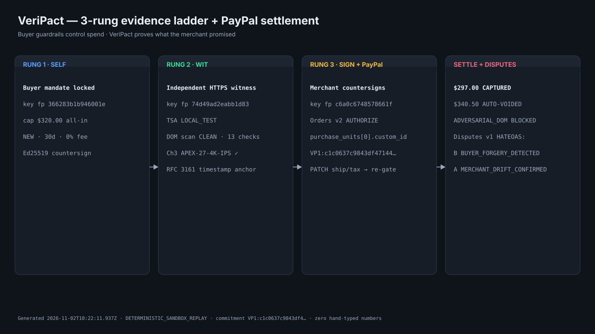
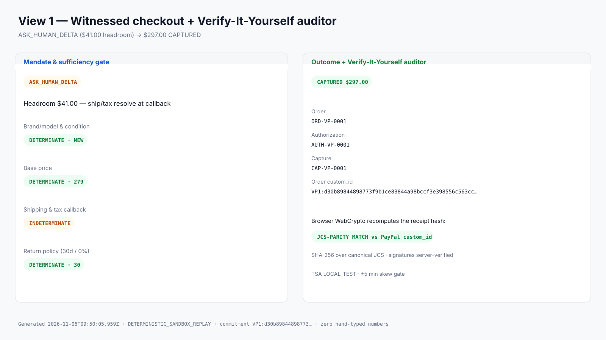
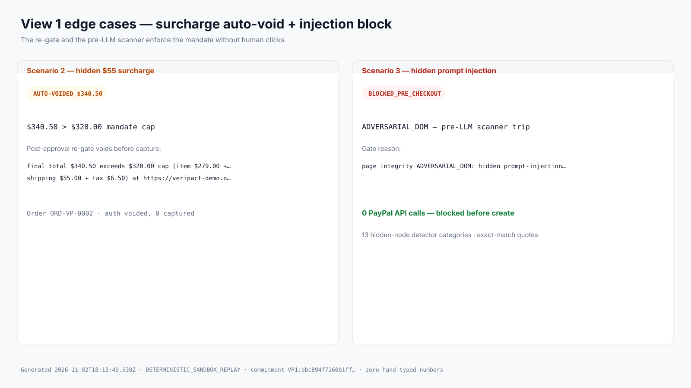
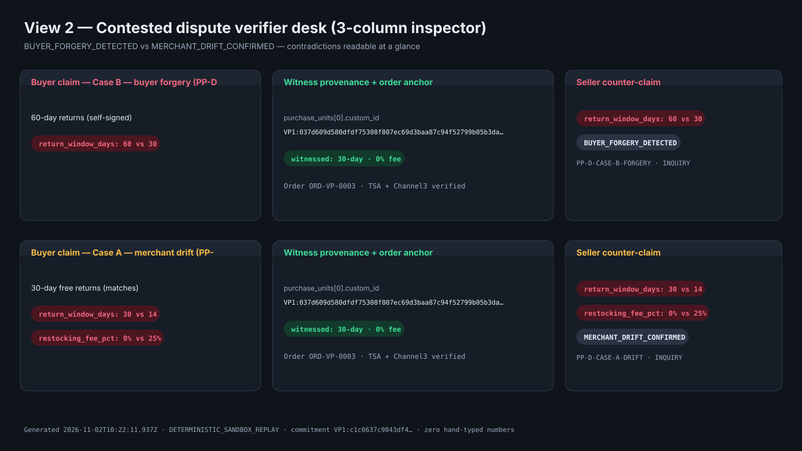
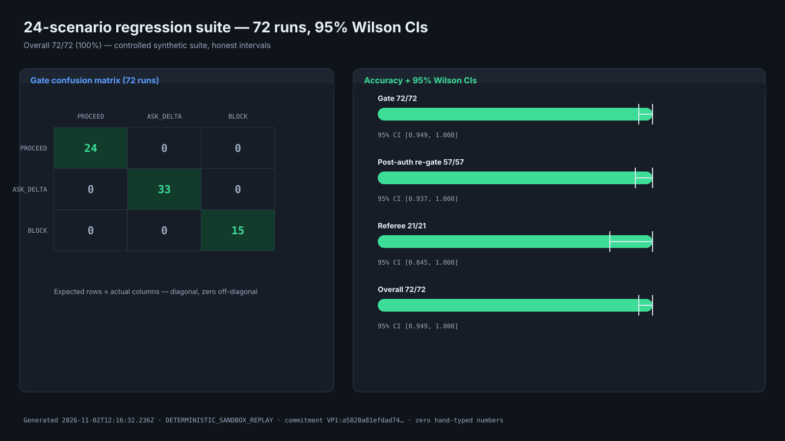
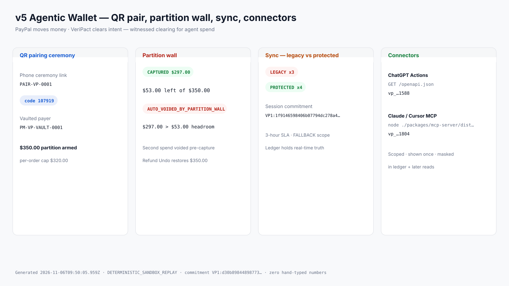

# VeriPact — Proving What the Merchant Promised

VeriPact is independent witness infrastructure for agentic commerce. An AI
shopping agent scans a merchant page, VeriPact witnesses exactly what the
page promised (price, condition, shipping, tax, return terms), time-anchors
the evidence, and binds a `VP1:` commitment into the PayPal order record —
so buyer-forgery and merchant-drift disputes settle on cryptographic
evidence instead of screenshots.

> **Buyer guardrails control what an agent is allowed to spend. VeriPact
> proves what the merchant actually promised.**

Built for [Build What's Next with PayPal and
AI](https://paypalaihackathon.devpost.com). Solo build + AI agents.

> **v5 thesis:** PayPal moves the money. VeriPact clears the intent — combining a Partitioned Agentic Wallet (QR pairing, hard sub-balance caps, ChatGPT/Claude connectors) with automatic 3-Rung (SELF → WIT → SIGN) merchant-promise witnessing on every payment.

## Visual Tour (60 Seconds)

Press **▶ Run 60s Guided Demo Tour** in the workbench header, or record it
headlessly with `npm run demo:record` (after `npx playwright install
chromium` once). Every frame below is rendered from a live SDK run via
`npm run assets:generate` — zero hand-typed numbers.


*The 3-rung SELF → WIT → SIGN ladder into PayPal Orders v2 / Disputes v1.*


*View 1: ASK_HUMAN_DELTA ($41 headroom) → $297.00 CAPTURED, browser WebCrypto JCS-PARITY MATCH.*


*Scenario 2 ($340.50 > $320 cap → AUTO-VOIDED) and Scenario 3 (ADVERSARIAL_DOM, zero PayPal calls).*


*View 2: Case B BUYER_FORGERY_DETECTED and Case A MERCHANT_DRIFT_CONFIRMED side by side.*


*72/72 runs, diagonal confusion matrix, honest 95% Wilson intervals.*


*v5: QR pair + $350 partition wall + legacy-vs-protected sync + ChatGPT/Claude connectors.*

## Sandbox Receipts Strip

`transport: LIVE_PAYPAL_SANDBOX` · generated 2026-11-06T05:52:02.665Z by
`npm run seed:sandbox` against `api-m.sandbox.paypal.com` (full values in
`docs/sandbox-receipts.json`).

| Scenario | Order ID | custom_id | Total | Status |
|---|---|---|---|---|
| normal | `1D1495603B138083R` | `VP1:e1c9eabe3c821dd3a72d47e7bcd6eba731024dc5ed42a3a2f7a0b03873134627` | $297.00 | CREATED (read-back match=true) |
| surcharge_void | `1DM45086A58528407` | `VP1:e0ea946fd40916eb1db67a7d9b2778d291c9d6f4e541fb0e976887fe10c10c56` | $340.50 | CREATED (read-back) |

Both receipts stop at CREATED: the founder approves each order as
the sandbox buyer, then runs Finalize for authorize / capture / void
(see §7 item 7). Live dispute listing at seed time: none.

## Verified Research Context

- [arXiv:2610.17378](https://arxiv.org/abs/2610.17378) — *Get In, Decide,
  Prove: A Merchant-Side Readiness Benchmark for Agentic Commerce.* In a
  330-merchant assessment, the all-in total was determinate at only **18 of
  330** merchants; the paper reports **137 of 178** decision failures traced
  to tax. Kept strictly separate from the paper's **555-site access
  census** (105 sites, 18.9%, unreadable to agents). VeriPact's
  `ASK_HUMAN_DELTA` gate exists for exactly this gap: ship/tax indeterminate
  pre-checkout, enforced post-approval by the re-gate.
- [arXiv:2606.08790](https://arxiv.org/abs/2606.08790) — *RAILS:
  Verification-Native Clearing For Agentic Commerce.* The verification
  ladder this project climbs: human-verified settlement for agent-arranged
  transactions.
- [arXiv:2609.11757](https://arxiv.org/abs/2609.11757) — *Signing the
  Transaction but Not the Decision.* Whisper attacks flip agent payment
  choices without touching signed bytes (90% / 56% / 73.3% across three
  attack families); VeriPact answers with witnessed, order-anchored
  commitments — the same binding class as the paper's A-VIP defense.

## v5 Agentic Wallet & Witnessed Clearing Thesis

The 3-rung checkout below is one half of the system. VeriPact v5
promotes it into an **Agentic Wallet & Witnessed Clearing System**:
PayPal moves money; VeriPact clears intent. Any external agent —
ChatGPT via a Custom GPT Action importing `GET /openapi.json`, or
Claude/Cursor via `@veripact/mcp-server` (stdio, 7 tools) — spends
through a QR-paired wallet with a hard sub-balance partition, and
every payment is automatically witnessed on the same 3-rung SELF,
WIT, SIGN rails: the phone QR pairing ceremony (`/pair/:sessionId`)
links a PayPal Vault payer and initializes the $350.00 agentic
partition ($320.00 per-order cap); the deterministic spend check
blocks or auto-voids overruns before capture; payment sync splits
`LEGACY_UNWITNESSED` history from `VERIPACT_PROTECTED` (`VP1:`)
transactions; scoped API credentials mint per platform and are
shown once. Verified end to end: **265/265 unit tests** (17 files)
plus a **25-step Playwright E2E** (pair, spend, wall, refund, deal sniper
sweep & auto-buy, sync, mint, multi-SKU across 4 viewports, zero overflow).

## Three-Rung Evidence Ladder

```text
Rung 1: SELF   buyer signs mandate + local terms ......... (buyer key)
Rung 2: WIT    independent witness snapshots the page,
               Channel3 cross-check, RFC 3161 anchor .... (witness key)
Rung 3: SIGN   merchant countersigns, PayPal AUTHORIZE
               binds VP1: commitment into custom_id ...... (merchant key)
```

```text
Merchant page → term-extractor (DOM scan, verified quotes, gate)
                    → witness-client (Channel3, TSA, signed WIT receipt)
                    → paypal-client (Orders v2 / Disputes v1 HATEOAS)
                    → sdk / cli / mcp-server / workbench
```

Keys never cross rungs: buyer, witness, and merchant private keys live in
separate env vars and separate code paths (`AGENTS.md` Rule 2). The
workbench demo server mounts the three boundaries as route groups in one
process for judge-click latency; production deploys them as disjoint
services (see §7).

## Omni-Surface Quickstart

Prerequisites: Node 20+, `npm install`, `npm run build`. Everything below
runs **offline with zero paid keys** (deterministic demo fixtures, labeled
`demoKeys` / `DETERMINISTIC_SANDBOX_REPLAY`). Drop sandbox credentials into
`.env` (see `.env.example`) to go live.

```bash
# 1. Web workbench (Sequoia UI + AG dispute desk) on :3000
npm start

# 2. CLI
npx veripact witness --scenario normal
npx veripact checkout --scenario surcharge_void
npx veripact audit-dispute --case buyer_forgery
npx veripact verify --scenario normal
npx veripact wallet-pair
npx veripact partition-create --label "Agentic" --total 350 --max-order 320 --ask-above 300
npx veripact partition-list
npx veripact wallet-sync

# 3. MCP server (stdio JSON-RPC for shopping agents)
node packages/mcp-server/dist/index.js
# 7 tools: veripact_witness_offer, veripact_execute_guarded_checkout,
# veripact_verify_order_receipt, veripact_adjudicate_contested_dispute,
# veripact_pair_wallet, veripact_sync_payments, veripact_partition_spend

# 4. Regression suite (24 scenarios × 3 passes, Wilson 95% CIs)
npm run regression

# 5. Live sandbox seeder (writes docs/sandbox-receipts.json)
npm run seed:sandbox

# 6. Visual assets (6 SVGs from live SDK data → docs/screenshots/)
npm run assets:generate

# 7. Demo recorder (Playwright 1600x900 video + PNGs → videos/)
npx playwright install chromium # once, on machines that allow sockets
npm run demo:record
```

One-click deploy: `render.yaml` builds the monorepo and starts the
workbench (`npm ci && npm run build` → `npm start`).

## Zero-Key Instant Evaluation vs Live PayPal Sandbox Mode

**Zero-key (default — judges start here).** No accounts, no secrets:
`npm install && npm run build && npm start`, open `:3000`, press
**▶ Run 60s Guided Demo Tour**. Every PayPal call runs against the
labeled `DETERMINISTIC_SANDBOX_REPLAY` engine; buyer approval happens in
the zero-key popup (`/sandbox/paypal-checkout`). `GET /api/system/status`
reports `transportMode`, credential presence, key fingerprints, and the
`72/72 (100%)` regression rate — never secret values.

**Live PayPal Sandbox (BYOK).** Drop `PAYPAL_CLIENT_ID` and
`PAYPAL_CLIENT_SECRET` into `.env` (see `.env.example`) — the header flips
to `● Live Sandbox Ready` with no restart, while first paint and the
guided tour keep running the instant 1-click deterministic flow (no live
order is minted until you ask). Check **Two-step approval (Live PayPal
checkoutnow)** and press **Authorize with PayPal** to mint a real sandbox
order: approve at PayPal's `checkoutnow` link as the buyer, then Finalize
runs authorize → re-gate → capture/void against the live order.
Post-purchase dispute simulation files into the labeled local desk
(`simulationDesk: true`) anchored to the real orderId + `VP1:` commitment —
PayPal exposes no file-dispute API, so the desk never claims to be a
PayPal chargeback (`AGENTS.md` Rule 3).

## 24-Scenario Regression Results (72 Runs, 95% Wilson CIs)

Controlled synthetic suite (`benchmark/scenarios/`): 8 benign retail flows,
8 fee/policy-drift flows, 8 adversarial/forgery flows — each through the
real witness → gate → PayPal replay → referee pipeline, 3 passes, zero
network cost. Full report: `benchmark/results/regression_benchmark_report.json`.

| Metric | Result | 95% Wilson CI |
|---|---|---|
| Gate decision (PROCEED / ASK / BLOCK) | 72/72 (100.0%) | [0.949, 1.000] |
| Post-approval re-gate (CAPTURE / VOID) | 57/57 (100.0%) | [0.937, 1.000] |
| Dispute referee (forgery / drift) | 21/21 (100.0%) | [0.845, 1.000] |
| Overall pass rate | 72/72 (100.0%) | [0.949, 1.000] |
| Benign group | 24/24 (100.0%) | [0.862, 1.000] |
| Drift group | 24/24 (100.0%) | [0.862, 1.000] |
| Adversarial group | 24/24 (100.0%) | [0.862, 1.000] |

Gate confusion (expected × actual): PROCEED 24, ASK_HUMAN_DELTA 33, BLOCK
15 — perfectly diagonal, zero off-diagonal cells.

## §7 Honesty & Limitations

1. **Timestamps prove hash existence at time T** plus independent witness
   observation. They never prove content truth.
2. **Witness isolation is logical in this demo.** Production deploys buyer,
   witness, and merchant as disjoint services (PayPal Store Sync is the
   production observation target); the workbench packages the three
   boundaries as route groups in one process so judges reach evidence in
   one click.
3. **Sandbox adjudication is simulated.** `adjudicate` exists only in the
   PayPal sandbox; live disputes resolve through PayPal's real flow, with
   VeriPact evidence attached as `OTHER`.
4. **The 18/330 figure is exact and bounded.** It counts merchants where
   the all-in total was determinate (arXiv:2610.17378) — not agent task
   success, and not the paper's separate 555-site access census.
5. **The regression suite is controlled, not a field benchmark.** 24
   synthetic storefronts assert the pipeline behaves as specified; they do
   not measure the open web. Intervals above are honest Wilson bounds on
   that suite.
6. **The Dispute Desk is a LOCAL SIMULATION.** Post-purchase filings
   land in the labeled local desk (`simulationDesk: true`) anchored to
   the real orderId and `VP1:` commitment; desk HATEOAS walks are
   `OTHER` evidence, never PayPal proof (PayPal exposes no
   file-dispute API).
7. **Live receipts are CREATED-only.** The AUTHORIZE to CAPTURE/VOID
   story is replay-proven; live capture/void needs the founder to
   approve each seeded order as the sandbox buyer and run Finalize.
8. **The surcharge custom_id match is withheld.** TSA timestamps use
   a real clock, so re-witnessing a live order yields a different
   hash; judge re-witness of live orders stays untested until a
   reproducible strategy lands — the withheld match is disclosed,
   not buried. Every order persists its `receiptCore`, so
   `computeCommitment(receiptCore)` stays deterministic and
   re-verifiable without re-witnessing.
9. **Transaction Search sync is async reconciliation.** Uncredentialed
   sync reports `FALLBACK_TO_REPLAY_AND_SESSION_ORDERS`; PayPal
   reporting carries up to a 3-hour indexing SLA plus non-unique
   transaction IDs, so the real-time partition balance always comes
   from the VeriPact Clearing Ledger, never from a reporting row.

Rule compliance: built for
[paypalaihackathon.devpost.com](https://paypalaihackathon.devpost.com). No
third-party trademarks in fixtures, UI, or video frames; no mocked PayPal
calls on live paths; every replay artifact is labeled.

---

MIT licensed. Repository: `https://github.com/Bhav-ikkk/VeriPact.git`.
