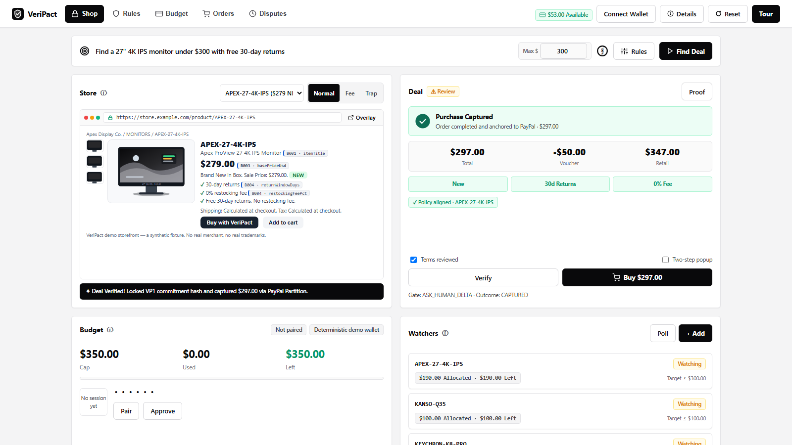
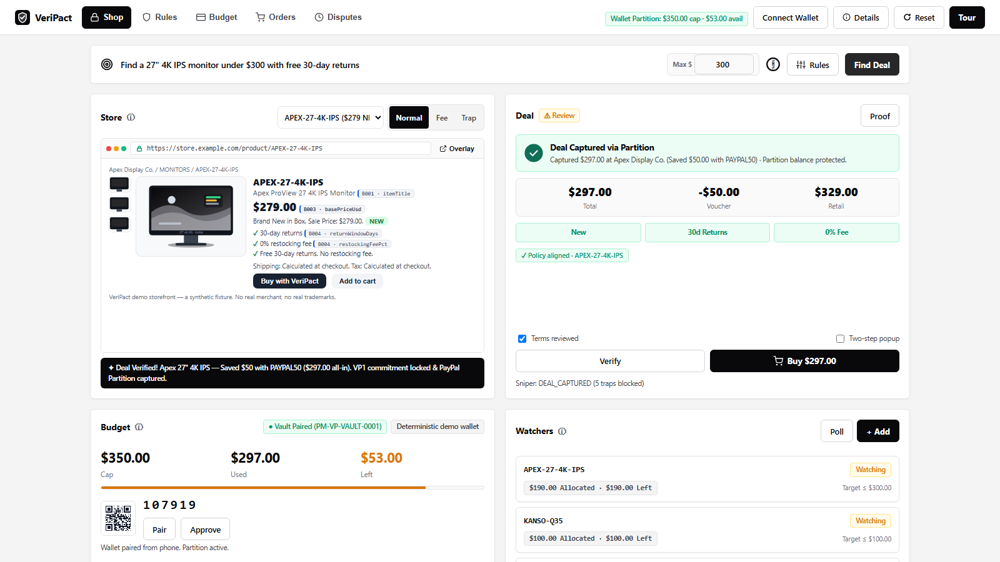
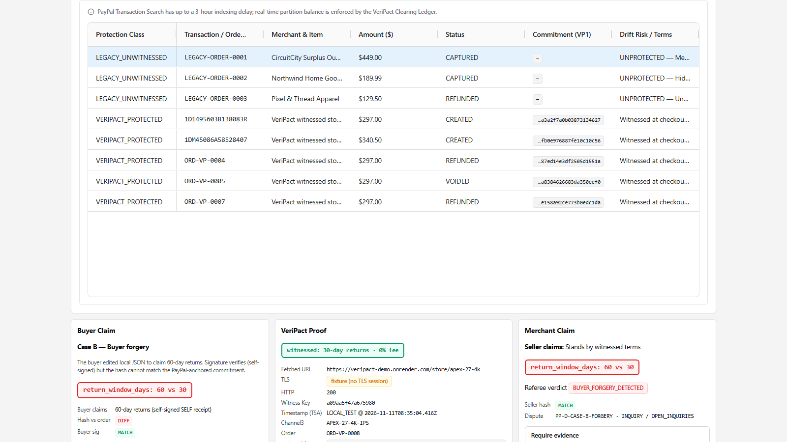
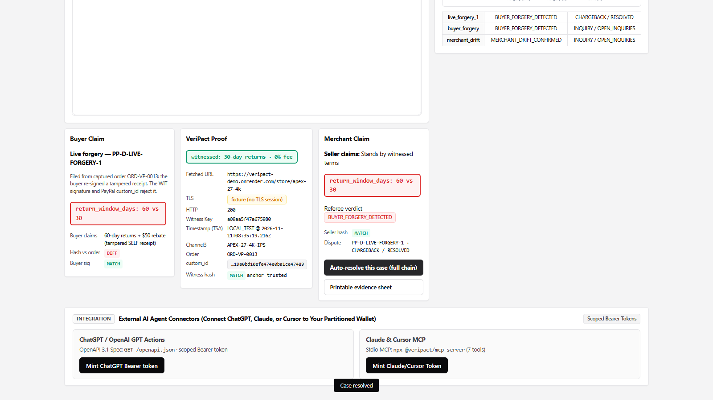
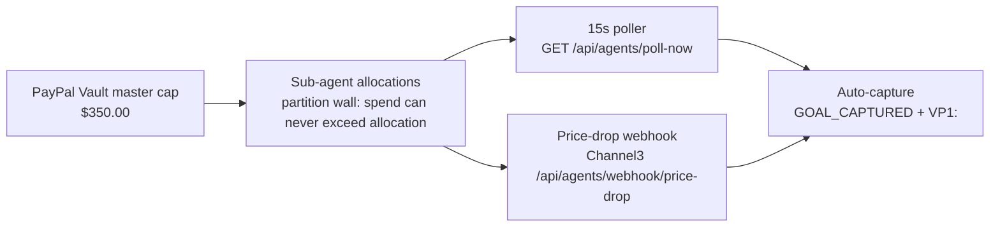
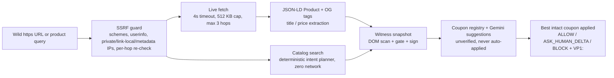

# VeriPact — Proving What the Merchant Promised

Give an AI shopping agent a payment method and two things break: nobody
constrains what it may spend before settlement, and nobody can prove what
the merchant actually promised after settlement. VeriPact fixes both
deterministically — a partitioned wallet clears intent before money moves,
and a three-rung cryptographic witness binds the observed merchant terms
into the PayPal order record, so post-purchase disputes settle on evidence
instead of screenshots.

> **Buyer guardrails control what an agent is allowed to spend. VeriPact
> proves what the merchant actually promised.**

Built for [Build What's Next with PayPal and
AI](https://paypalaihackathon.devpost.com). Solo build + AI agents.

> **v5 thesis:** PayPal moves the money. VeriPact clears the intent — combining a Partitioned Agentic Wallet (QR pairing, hard sub-balance caps, ChatGPT/Claude connectors) with automatic 3-Rung (SELF → WIT → SIGN) merchant-promise witnessing on every payment.

## Visual Evidence (refreshed, monochrome UI)

Every frame below is a real render of the locked monochrome workbench
(zinc canvas, carbon actions, equal-height 2-card rows, 36px controls),
regenerated by `npm run demo:record` — 16 PNGs, zero page problems.


*The 2-card workspace: Store + Deal (equal heights), Budget + Watchers below.*


*6-store coupon/trap audit: PAYPAL50 wins, CLEARANCE70 voids returns, VIP60 needs $500+, FreightKing hides a $55 callback.*


*Background price-drop watcher (Watchers card): SKU rows with allocations, targets, and Watching/Captured badges; KANSO-Q35 auto-captures $149 → $100 on webhook.*


*Single AG Grid orders view: legacy unwitnessed history split from VP1:-protected payments.*


*3-column dispute referee: buyer claim vs witness provenance vs seller counter-claim, resolved on anchored evidence.*

Data-driven SVG diagrams (rendered from live SDK runs via
`npm run assets:generate` — zero hand-typed numbers):


*The 3-rung SELF → WIT → SIGN ladder into PayPal Orders v2 / Disputes v1.*


*View 1: ASK_HUMAN_DELTA ($41 headroom) → $297.00 CAPTURED, browser WebCrypto JCS-PARITY MATCH.*


*Scenario 2 ($340.50 > $320 cap → AUTO-VOIDED) and Scenario 3 (ADVERSARIAL_DOM, zero PayPal calls).*


*View 2: Case B BUYER_FORGERY_DETECTED and Case A MERCHANT_DRIFT_CONFIRMED side by side.*


*72/72 runs, diagonal confusion matrix, honest 95% Wilson intervals.*


*v5: QR pair + $350 partition wall + legacy-vs-protected sync + ChatGPT/Claude connectors.*

## How It Works

### 1. The 3-Rung Cryptographic Pipeline

```mermaid
flowchart LR
    B[Buyer: SELF mandate<br/>Ed25519-signed intent] --> W[WITNESS rung<br/>HTTPS fetch → 13-rule DOM scan → quote verify → sufficiency gate]
    W --> C[Channel3 oracle<br/>condition + price cross-check]
    C --> T[RFC 3161 TSA<br/>hash existence at time T]
    T --> S[SIGN rung<br/>merchant countersigns]
    S --> P[PayPal Orders v2<br/>VP1: commitment in purchase_units[0].custom_id]
    P --> G[Guarded flow<br/>AUTHORIZE → PATCH → re-gate → CAPTURE or auto-VOID]
```

Rung 1 SELF: the buyer signs a mandate (SKU, max all-in, 30-day returns,
new condition). Rung 2 WIT: an independent witness fetches the merchant
page, scans for hidden-DOM attacks, extracts substring-verified quotes,
gates sufficiency (`PROCEED / ASK_HUMAN_DELTA / BLOCK`), cross-checks the
Channel3 catalog oracle, and anchors the evidence hash with an RFC 3161
timestamp. Rung 3 SIGN: the merchant countersigns and the `VP1:`
commitment lands in the PayPal order's `custom_id`. Settlement stays
guarded after approval: shipping/tax callbacks trigger a post-approval
re-gate that captures ($297.00) or auto-voids ($340.50 over the $320 cap).

### 2. Partition & Background Price-Watcher Engine



Phone QR pairing links a PayPal Vault payer and opens the $350 master
partition; each watcher (APEX-27-4K-IPS, KANSO-Q35, KEYCHRON-K8-PRO) gets
a hard sub-allocation the partition wall enforces on every spend. A 15s
poller (also triggerable by Vercel Cron over `GET /api/agents/poll-now`)
and Channel3 price-drop webhooks drive autonomous capture: KANSO-Q35
goes $149 → $100 with AUDIO67 the moment the webhook lands.

### 3. Wild-URL & Live Coupon Hunter (`/api/agents/web-hunt`)



Paste any live URL or type any query: the hunter SSRF-guards the target,
fetches raw HTTPS HTML (no headless Chromium per domain), extracts
JSON-LD/OpenGraph terms, runs the full witness snapshot, evaluates the
9-code coupon registry (CLEARANCE70 rejected for voiding returns, VIP60
gated on $500+), and returns a signed `VP1:` report with the best
terms-intact coupon applied.

### Package map

| Package | Responsibility |
|---|---|
| `@veripact/core` | Canonical domain types, `VP1:` commitments, Ed25519 + RFC 8785 + RFC 3161 primitives, referee interfaces |
| `@veripact/term-extractor` | 13-rule hidden-DOM scanner, substring-verified quote extractor, mandate-aware sufficiency gate |
| `@veripact/witness-client` | Rung 2 witness: HTTPS snapshotter, Channel3 oracle, TSA anchoring |
| `@veripact/paypal-client` | Orders v2 builders, webhooks, Payments v2, Disputes v1 HATEOAS engine, sandbox replay engine |
| `@veripact/sdk` | `VeriPactClient` facade, deal sniper, intent planner, web hunter, wallet, regression suites |
| `@veripact/cli` | `veripact` executable (witness, checkout, audit, wallet, partition commands) |
| `@veripact/mcp-server` | Stdio JSON-RPC 2.0 MCP server (7 tools) for external shopping agents |
| `@veripact/workbench` | Monochrome web UI + single-process HTTP server + Vercel adapter |

## Verification & Benchmarks

Exact verified numbers (this tree, `npm run lint && npm run typecheck && npm run build && npm test && npm run verify:e2e` all exit 0):

| Suite | Result | Artifact |
|---|---|---|
| Unit + integration (vitest) | **349/349 across 19 suites** | `packages/*/test/` |
| Playwright E2E | **28/28 steps, 4 viewports** (1600×900, 1366×768, 1050×800, 768×1024), zero 4xx/5xx, zero console errors | `scripts/verify-ui-e2e.ts` |
| UI geometry assertions | Card-row heights/tops **±2px**, action buttons **36px ±2px**, rest+hover contrast | E2E `geo@1600` / `geo@1366` |
| Multi-agent swarm stress | **60/60 runs** (16 catalog + 12 poller/webhook + 12 red-team + 10 concurrency + 10 referee) | `benchmark/results/multi_agent_swarm_report.json` |
| 24-scenario regression | **72/72 gate decisions** (24 scenarios × 3 passes), diagonal confusion matrix | `benchmark/results/regression_benchmark_report.json` |
| JCS parity | Browser canonicalizer byte-tested against the server | `workbench.test.ts` auditor parity |
| Demo recorder | 16 PNGs + `.webm`, zero page problems | `docs/screenshots/live-*.png` |

Controlled synthetic suite (`benchmark/scenarios/`): 8 benign retail flows,
8 fee/policy-drift flows, 8 adversarial/forgery flows — each through the
real witness → gate → PayPal replay → referee pipeline, 3 passes, zero
network cost.

| Metric | Result | 95% Wilson CI |
|---|---|---|
| Gate decision (PROCEED / ASK / BLOCK) | 72/72 (100.0%) | [0.949, 1.000] |
| Post-approval re-gate (CAPTURE / VOID) | 57/57 (100.0%) | [0.937, 1.000] |
| Dispute referee (forgery / drift) | 21/21 (100.0%) | [0.845, 1.000] |
| Overall pass rate | 72/72 (100.0%) | [0.949, 1.000] |
| Benign group | 24/24 (100.0%) | [0.862, 1.000] |
| Drift group | 24/24 (100.0%) | [0.862, 1.000] |
| Adversarial group | 24/24 (100.0%) | [0.862, 1.000] |

Gate confusion (expected × actual): PROCEED 24, ASK_HUMAN_DELTA 33, BLOCK
15 — perfectly diagonal, zero off-diagonal cells.

## Live Sandbox Receipts

`transport: LIVE_PAYPAL_SANDBOX` · generated 2026-11-06T05:52:02.665Z by
`npm run seed:sandbox` against `api-m.sandbox.paypal.com` (full values in
`docs/sandbox-receipts.json`).

| Scenario | Order ID | custom_id | Total | Status |
|---|---|---|---|---|
| normal | `1D1495603B138083R` | `VP1:e1c9eabe3c821dd3a72d47e7bcd6eba731024dc5ed42a3a2f7a0b03873134627` | $297.00 | CREATED (read-back match=true) |
| surcharge_void | `1DM45086A58528407` | `VP1:e0ea946fd40916eb1db67a7d9b2778d291c9d6f4e541fb0e976887fe10c10c56` | $340.50 | CREATED (read-back) |

Both receipts stop at CREATED: the founder approves each order as
the sandbox buyer, then runs Finalize for authorize / capture / void.
Live dispute listing at seed time: none.

## Verified Research Context

- [arXiv:2610.17378](https://arxiv.org/abs/2610.17378) — *Get In, Decide,
  Prove: A Merchant-Side Readiness Benchmark for Agentic Commerce.* In a
  330-merchant assessment, the all-in total was determinate at only **18 of
  330** merchants; the paper reports **137 of 178** decision failures traced
  to tax. Kept strictly separate from the paper's **555-site access
  census** (105 sites, 18.9%, unreadable to agents). VeriPact's
  `ASK_HUMAN_DELTA` gate exists for exactly this gap: ship/tax indeterminate
  pre-checkout, enforced post-approval by the re-gate.
- [arXiv:2606.08790](https://arxiv.org/abs/2606.08790) — *RAILS:
  Verification-Native Clearing For Agentic Commerce.* The verification
  ladder this project climbs: human-verified settlement for agent-arranged
  transactions.
- [arXiv:2609.11757](https://arxiv.org/abs/2609.11757) — *Signing the
  Transaction but Not the Decision.* Whisper attacks flip agent payment
  choices without touching signed bytes (90% / 56% / 73.3% across three
  attack families); VeriPact answers with witnessed, order-anchored
  commitments — the same binding class as the paper's A-VIP defense.

## Omni-Surface Quickstart

Prerequisites: Node 20+, `npm install`, `npm run build`. Everything below
runs **offline with zero paid keys** (deterministic demo fixtures, labeled
`demoKeys` / `DETERMINISTIC_SANDBOX_REPLAY`). Drop sandbox credentials into
`.env` (see `.env.example`) to go live.

```bash
# 1. Web workbench (monochrome UI + AG dispute desk) on :3000
npm start

# 2. CLI
npx veripact witness --scenario normal
npx veripact checkout --scenario surcharge_void
npx veripact audit-dispute --case buyer_forgery
npx veripact verify --scenario normal
npx veripact wallet-pair
npx veripact partition-create --label "Agentic" --total 350 --max-order 320 --ask-above 300
npx veripact partition-list
npx veripact wallet-sync

# 3. MCP server (stdio JSON-RPC for shopping agents)
node packages/mcp-server/dist/index.js
# 7 tools: veripact_witness_offer, veripact_execute_guarded_checkout,
# veripact_verify_order_receipt, veripact_adjudicate_contested_dispute,
# veripact_pair_wallet, veripact_sync_payments, veripact_partition_spend

# 4. Regression suite (24 scenarios × 3 passes, Wilson 95% CIs)
npm run regression

# 5. Live sandbox seeder (writes docs/sandbox-receipts.json)
npm run seed:sandbox

# 6. Visual assets (6 SVGs from live SDK data → docs/screenshots/)
npm run assets:generate

# 7. Demo recorder (Playwright 1600x900 video + PNGs → videos/)
npx playwright install chromium # once, on machines that allow sockets
npm run demo:record
```

One-click deploys: `render.yaml` builds the monorepo and starts the
workbench (`npm ci && npm run build` → `npm start`); `vercel.json`
routes every path through the `api/index.mjs` serverless adapter
(`handleWorkbenchRequest`, 30s max duration), with wallet/fleet state
mirrors resolving into `os.tmpdir()` on Vercel so the read-only
`/var/task` filesystem never throws `EROFS`.

## Zero-Key Instant Evaluation vs Live PayPal Sandbox Mode

**Zero-key (default — judges start here).** No accounts, no secrets:
`npm install && npm run build && npm start`, open `:3000`, press
**Tour** for the 60s guided demo tour. Every PayPal call runs against the
labeled `DETERMINISTIC_SANDBOX_REPLAY` engine; buyer approval happens in
the zero-key popup (`/sandbox/paypal-checkout`). `GET /api/system/status`
reports `transportMode`, credential presence, key fingerprints, and the
`72/72 (100%)` regression rate — never secret values.

**Live PayPal Sandbox (BYOK).** Drop `PAYPAL_CLIENT_ID` and
`PAYPAL_CLIENT_SECRET` into `.env` (see `.env.example`) — no restart
needed, while first paint and the guided tour keep running the instant
1-click deterministic flow (no live order is minted until you ask). Check
**Two-step popup (live)** and press **Authorize $297.00** to mint a real
sandbox order: approve at PayPal's `checkoutnow` link as the buyer, then
Finalize runs authorize → re-gate → capture/void against the live order.
Post-purchase dispute simulation files into the labeled local desk
(`simulationDesk: true`) anchored to the real orderId + `VP1:` commitment —
PayPal exposes no file-dispute API, so the desk never claims to be a
PayPal chargeback (`AGENTS.md` Rule 3).

## Where It Breaks (Honest Architectural Boundaries & Limitations)

1. **Client-hydrated SPAs vs. SSR HTML on wild URLs** (`/api/agents/web-hunt`).
   The hunter fetches raw HTTPS HTML (≤ 512 KB, 4000 ms timeout, max 3
   redirect hops) without spinning up headless Chromium per external
   domain; if return terms only mount via client JS, the extractor
   returns INDETERMINATE and the gate fails closed (BLOCK).
2. **DNS rebinding vs. literal-IP SSRF guard.** The guard blocks
   private/loopback/link-local/metadata IPs (`127.0.0.0/8`,
   `10.0.0.0/8`, `172.16.0.0/12`, `192.168.0.0/16`, `169.254.169.254`,
   `::1`, `fe80::/10`, `fc00::/7`) on the initial URL and across every
   redirect hop, relying on Node's standard DNS resolver — DNS
   rebinding past that resolver is out of scope.
3. **Epistemic boundary of RFC 3161 timestamps.** A timestamp proves
   that the canonical `VP1:` receipt hash existed at time T and was
   signed by the witness key (WIT) — not physical warehouse inventory
   truth.
4. **Unverified LLM coupon candidates.** Gemini-suggested promo codes
   are marked `verifiedTermsIntact: false` and are never auto-applied;
   only deterministic registry codes with intact witnessed terms can
   become `appliedCoupon`.
5. **PayPal Transaction Search indexing lag.** PayPal's reporting API
   takes up to 3 hours to index new captures, so real-time partition
   walls are enforced by the VeriPact Clearing Ledger (Neon serverless
   Postgres when `NEON_DATABASE_URL` is set, file-locked local mirror
   otherwise) — never by a reporting row.

## §7 Honesty & Limitations

1. **Timestamps prove hash existence at time T** plus independent witness
   observation. They never prove content truth.
2. **Witness isolation is logical in this demo.** Production deploys buyer,
   witness, and merchant as disjoint services (PayPal Store Sync is the
   production observation target); the workbench packages the three
   boundaries as route groups in one process so judges reach evidence in
   one click.
3. **Sandbox adjudication is simulated.** `adjudicate` exists only in the
   PayPal sandbox; live disputes resolve through PayPal's real flow, with
   VeriPact evidence attached as `OTHER`.
4. **The 18/330 figure is exact and bounded.** It counts merchants where
   the all-in total was determinate (arXiv:2610.17378) — not agent task
   success, and not the paper's separate 555-site access census.
5. **The regression suite is controlled, not a field benchmark.** 24
   synthetic storefronts assert the pipeline behaves as specified; they do
   not measure the open web. Intervals above are honest Wilson bounds on
   that suite.
6. **The Dispute Desk is a LOCAL SIMULATION.** Post-purchase filings
   land in the labeled local desk (`simulationDesk: true`) anchored to
   the real orderId and `VP1:` commitment; desk HATEOAS walks are
   `OTHER` evidence, never PayPal proof (PayPal exposes no
   file-dispute API).
7. **Live receipts are CREATED-only.** The AUTHORIZE to CAPTURE/VOID
   story is replay-proven; live capture/void needs the founder to
   approve each seeded order as the sandbox buyer and run Finalize.
8. **The surcharge custom_id match is withheld.** TSA timestamps use
   a real clock, so re-witnessing a live order yields a different
   hash; judge re-witness of live orders stays untested until a
   reproducible strategy lands — the withheld match is disclosed,
   not buried. Every order persists its `receiptCore`, so
   `computeCommitment(receiptCore)` stays deterministic and
   re-verifiable without re-witnessing.
9. **Transaction Search sync is async reconciliation.** Uncredentialed
   sync reports `FALLBACK_TO_REPLAY_AND_SESSION_ORDERS`; PayPal
   reporting carries up to a 3-hour indexing SLA plus non-unique
   transaction IDs, so the real-time partition balance always comes
   from the VeriPact Clearing Ledger, never from a reporting row.

Rule compliance: built for
[paypalaihackathon.devpost.com](https://paypalaihackathon.devpost.com). No
third-party trademarks in fixtures, UI, or video frames; no mocked PayPal
calls on live paths; every replay artifact is labeled.

---

MIT licensed. Repository: `https://github.com/Bhav-ikkk/VeriPact.git`.
